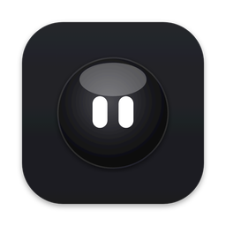
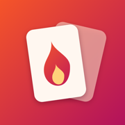
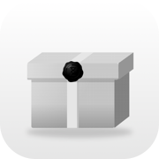
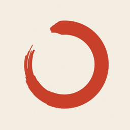
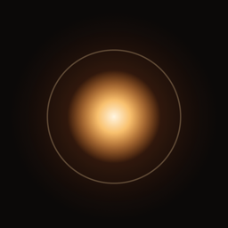
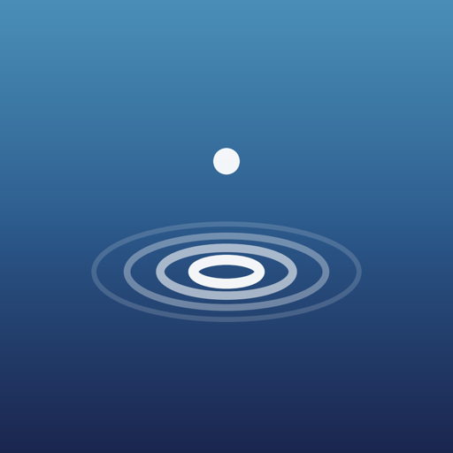
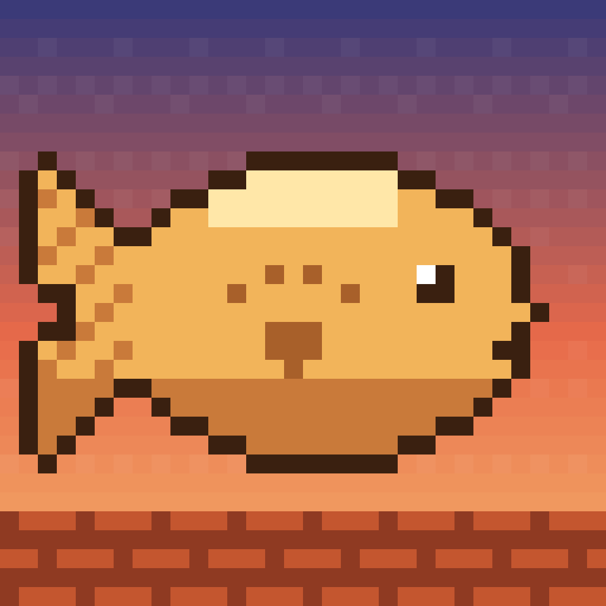

# CloudLabs

Sou um programador independente em Portugal e a CloudLabs é a marca com que publico as minhas apps. Faço tudo sozinho, do código ao design: apps para Mac, Windows, iPhone e web, pensadas para serem simples e úteis no dia a dia. Aqui estão todas num só sítio, com o link para cada uma.

---

## Orbe

Um orbe com olhos que fica por cima de todas as janelas e abre o assistente de IA que já usas (Claude, ChatGPT, Gemini, Grok ou SciSpace), com a tua conta. A app para iPhone envia fotos, páginas digitalizadas e perguntas para a IA aberta no computador.

**Plataformas:** Mac (macOS 13 ou mais recente) · Windows 10 e 11 · iPhone

[Site](https://get-orbe.com) · [Download para Mac e Windows](https://get-orbe.com/instalar) · Código fechado · App Store — em breve (em aprovação na UE)

 

## Dare for Two

Um jogo de cartas para casais: começa leve e vai aquecendo, só até onde os dois quiserem. 300 cartas em quatro baralhos, sem contas, sem anúncios e sem rastreio. Para maiores de 18.

**Plataformas:** iPhone · iPad · Mac

[Site](https://darefortwo.vercel.app) · Código fechado · App Store — em breve (em aprovação na UE)

 

## OpenLater

Uma caixa de lembranças pessoal: tiras fotos, gravas vídeos e notas de voz ou escreves notas dentro da app, sem ver o que captaste, e selas a caixa com um selo de cera. Ela só abre na data que escolhes ou quando voltas ao sítio onde a selaste, o que acontecer primeiro. Se não aguentares, podes abri-la antes a pagar, e o selo fica partido. As caixas ficam iguais no iPhone, no iPad e no Mac pelo iCloud, com tudo cifrado. 14 idiomas. Grátis, sem contas, sem anúncios e sem rastreio; o OpenLater+ é uma subscrição opcional.

**Plataformas:** iPhone · iPad · Mac

[Site](https://openlater-app.vercel.app) · Código fechado · App Store — em breve (em revisão pela Apple)

 

## Rich Light

Um botão grande que liga e desliga a lanterna do iPhone. Modo claro, escuro e OLED, 14 idiomas. Desbloqueio único, sem subscrições nem anúncios.

**Plataformas:** iPhone

[Site](https://richlight.vercel.app) · Código fechado · App Store — em breve (em aprovação na UE)

 

## Ma 間

Um temporizador Pomodoro calmo, com um ensō pintado a pincel no centro. Tudo o que conta o tempo é grátis: ciclos, notificações, Live Activity, widgets, estatísticas e sincronização por iCloud. O Ma Plus é um desbloqueio único só para a estética (temas japoneses, mostradores, sons), sem subscrições nem anúncios. 14 idiomas.

**Plataformas:** iPhone · iPad · Mac · Web (temporizador no site)

[Site e temporizador web](https://mapomodoro.pages.dev) · Código fechado · App Store — em breve (em testes no TestFlight)

 

## Lume

Um ecrã sempre ligado, calmo e personalizável, para deixar ao lado enquanto trabalhas ou descansas. Inspirado no ecrã de bloqueio do iPhone: fotos com efeito de profundidade, relógio com nove tipos de letra, espessura, tamanho e cor à escolha, e widgets de tempo, calendário, bateria, sol, lua, contagem decrescente e relógio mundial. À noite fica em vermelho escuro e, quando ninguém toca, escurece como o ecrã sempre ligado. Sem contas, sem anúncios e sem rastreio.

**Plataformas:** iPad · iPhone · Mac

Código fechado · App Store — em breve (em testes no TestFlight)

 

## Sereno

Sons ambiente para focar, relaxar e dormir: 70 sons originais em oito categorias (chuva, água, floresta e campo, vento e fogo, viagem e cidade, casa, ruído, binaurais e tons), que podes misturar à vontade. Continua a tocar com o ecrã bloqueado e sem internet, tem temporizador para dormir e misturas guardadas, em 14 idiomas. Grátis, sem anúncios, sem contas e sem rastreio.

**Plataformas:** iPhone · iPad · Mac

[Site](https://sereno-brown.vercel.app) · Código fechado · App Store — em breve (em testes no TestFlight)

 

## Tilepaw

Um jogo de corrida em pixel art: és um gato a correr pelos telhados até casa. Tocas para saltar e voltas a tocar no ar para o salto duplo, por cima de prédios, varandas e obstáculos. O dia passa do nascer do sol à noite e a corrida fica cada vez mais rápida. Oito capitais (Lisboa, Londres, Paris, Roma, Tóquio, Cairo, Cidade do México e Buenos Aires), oito personagens com skins, ranking global no Game Center e 8 idiomas.

**Plataformas:** iPhone · iPad

Código fechado · App Store — em breve (em testes no TestFlight)

 

---

## Resumo

| App | Plataformas | Estado | Links |
|---|---|---|---|
| Orbe | Mac, Windows, iPhone | Disponível no Mac e no Windows | [Site](https://get-orbe.com) · [Download](https://get-orbe.com/instalar) · App Store — em breve (em aprovação na UE) |
| Dare for Two | iPhone, iPad, Mac | Em breve | [Site](https://darefortwo.vercel.app) · App Store — em breve (em aprovação na UE) |
| OpenLater | iPhone, iPad, Mac | Em breve | [Site](https://openlater-app.vercel.app) · App Store — em breve (em revisão pela Apple) |
| Rich Light | iPhone | Em breve | [Site](https://richlight.vercel.app) · App Store — em breve (em aprovação na UE) |
| Ma 間 | iPhone, iPad, Mac, Web | Temporizador disponível na web | [Site](https://mapomodoro.pages.dev) · App Store — em breve (em testes no TestFlight) |
| Lume | iPad, iPhone, Mac | Em breve | App Store — em breve (em testes no TestFlight) |
| Sereno | iPhone, iPad, Mac | Em breve | [Site](https://sereno-brown.vercel.app) · App Store — em breve (em testes no TestFlight) |
| Tilepaw | iPhone, iPad | Em breve | App Store — em breve (em testes no TestFlight) |

Contacto e novidades: [@cloudlabsdev no X](https://x.com/cloudlabsdev)
